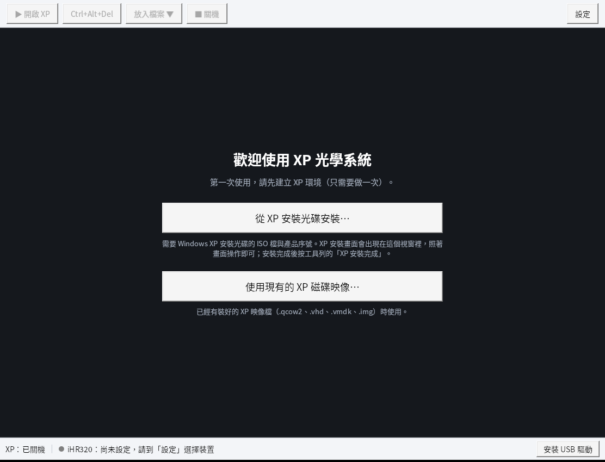
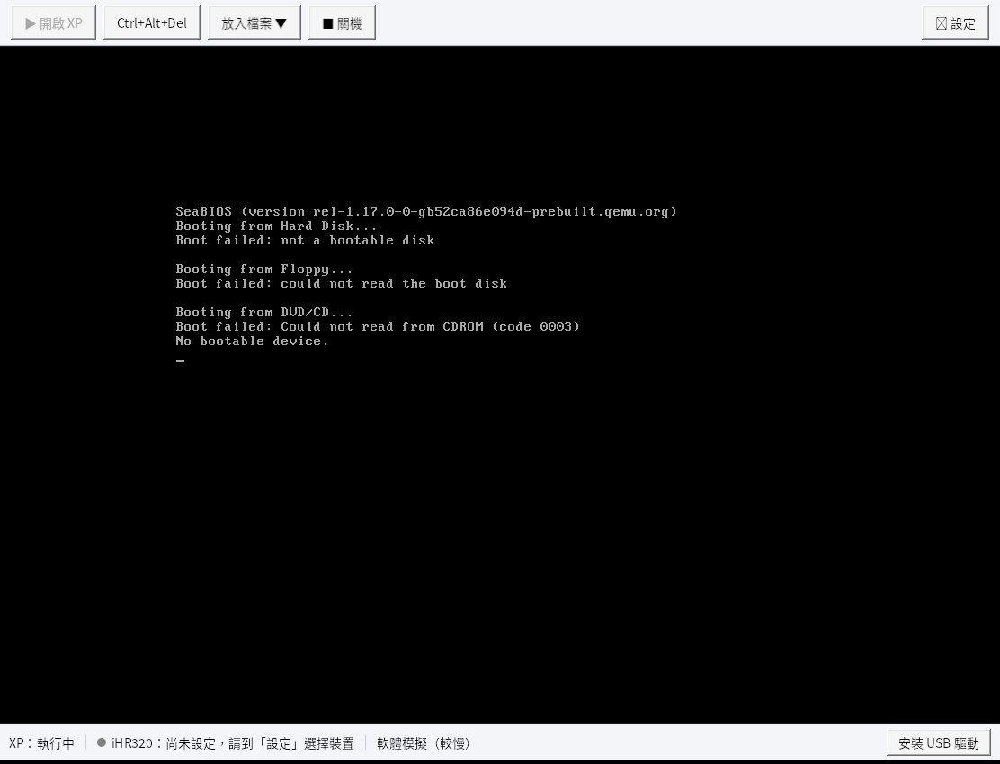

# WinXP Optical System（XP 光學系統）

在 Windows 10/11 上執行只能在 Windows XP 運作的光學軟體，首要支援 **HORIBA iHR320 分光儀（USB）**。

- **繁體中文、簡易上手**：第一次跟著畫面建立 XP 環境；之後雙擊開啟，按 ✕ 自動存檔
- **可獨立運行**：免安裝資料夾，自帶 .NET 執行環境與 XP 執行引擎，不需另外安裝任何執行環境
- **USB 最佳化**：事件驅動轉送（避開現有方案在 Windows 上的 10 ms 輪詢延遲）、插拔自動重新接入、免手動換驅動
- **像關機一樣保存**：關閉時快速休眠，下次數秒內回到原畫面
- **安全隔離**：XP 不連網；檔案以唯讀光碟放進 XP

> 目前版本：**v0.1.0**。程式已可在雲端完整建置與測試；尚待 Win11 實機 + iHR320 驗證（見 [docs/PHASE0-POC.md](docs/PHASE0-POC.md)）。

## 畫面

| 第一次使用 | XP 執行中（此為測試用空白磁碟的開機畫面） |
|---|---|
|  |  |

> 截圖來自雲端測試環境（Wine，字型為 Noto Sans CJK）；在 Windows 上會使用微軟正黑體。

## 取得程式

- **下載**：GitHub 的 Actions 頁面 →「建置與測試」最新一次執行 → Artifacts 的 `XPOptical-win-x64`。解壓縮後整個資料夾就是免安裝版。
- **自行建置**：見下方「開發」。

使用方式見免安裝版資料夾內的 [`使用說明.txt`](packaging/使用說明.txt)。

## 功能（v0.1.0）

| 功能 | 狀態 |
|---|---|
| XP 畫面內嵌在繁中主視窗（整數倍縮放、掃描碼鍵盤、絕對座標滑鼠、Ctrl+Alt+Del 按鈕） | ✅ |
| 從 XP 安裝光碟（ISO）安裝 XP、繼續未完成的安裝、匯入現有磁碟映像 | ✅ |
| 關閉視窗自動休眠、開啟時恢復；或選擇正常關機 | ✅ |
| iHR320 自動接入 XP（插拔、斷電後自動重新接入），連線失敗時顯示中文原因 | ✅ |
| 「放入檔案」：把資料夾或檔案做成光碟放進 XP（也可直接拖進視窗） | ✅ |
| 把隨身碟等其他 USB 裝置接進 XP（拿出量測資料用） | ✅ |
| 一鍵安裝 USB 驅動（UsbDk）；不需開啟 Hyper-V / Hypervisor Platform | ✅ |
| 資料夾路徑含中文時自動處理 | ✅ |
| 一鍵產生問題回報（紀錄檔 + 環境資訊 zip） | ✅ |
| XP 無人值守自動安裝、量測資料自動同步、還原點 | 下一階段 |

## 專案結構

```
src/XPOptical.Core/        核心（不依賴介面）：QEMU 控制、休眠、USB 接入、VNC、光碟映像
src/XPOptical.App/         Windows 主程式（WPF，繁體中文）
tests/XPOptical.Core.Tests 單元測試 + 以真實 QEMU 執行的整合測試
tools/build-engine.py      從 MSYS2 組裝 Windows 版執行引擎（只取實際用到的 DLL）
tools/package.sh           產生免安裝版資料夾與 zip
tools/package.ps1          同上（Windows 版）
tools/test-windows-engine.sh  用 Wine 對隨附的 Windows 版引擎跑整合測試
profiles/ihr320.json       iHR320 裝置設定檔
packaging/                 使用說明與第三方授權說明
docs/                      設計文件、實機驗證步驟、開發環境
```

## 開發

需要 Microsoft 官方 .NET 10 SDK（Ubuntu 套件版的 dotnet 不含 WPF 編譯支援）、python3、zstd；整合測試需要 `qemu-system-x86_64`（或 i386）與 `qemu-img`。

```bash
dotnet test tests/XPOptical.Core.Tests    # 單元 + 整合測試
./tools/package.sh                         # 產生 dist/XPOptical 與 zip
powershell -ExecutionPolicy Bypass -File tools\package.ps1   # 在 Windows 上產生同樣的免安裝版
./tools/test-windows-engine.sh             # （選用，需 wine64）測試隨附的 Windows 版引擎
```

雲端開發環境的設定見 [docs/DEV-ENVIRONMENT.md](docs/DEV-ENVIRONMENT.md)。

## 文件

| 文件 | 內容 |
|---|---|
| [docs/DESIGN.md](docs/DESIGN.md) | 系統設計與實作狀態 |
| [docs/PHASE0-POC.md](docs/PHASE0-POC.md) | Win11 實機 + iHR320 驗證步驟 |
| [docs/DEV-ENVIRONMENT.md](docs/DEV-ENVIRONMENT.md) | 開發環境規格與設定腳本 |
| [docs/LOCAL-TESTER.md](docs/LOCAL-TESTER.md) | 給本機測試端（Win11 + iHR320）的說明：取得新版、測試、回報 |

## 已知限制

- 不支援 PCI/PCIe 介面卡直通（Windows 10/11 的限制）
- 不附帶 Windows XP 與光學軟體，使用者須自備合法授權並自行安裝
- v0.1 的量測資料需透過隨身碟拿出（自動同步在下一階段）

## 授權

本專案的程式碼以 [MIT License](LICENSE) 授權。

免安裝版隨附的第三方元件依各自的授權散布（QEMU 等為 GPL/LGPL、UsbDk 為 Apache 2.0、.NET 與 DiscUtils 為 MIT），
清單與授權全文見免安裝版內的 `THIRD-PARTY-NOTICES.txt`、`engine/THIRD-PARTY-NOTICES.txt`、`engine/licenses/`。
本專案不包含也不散布 Windows XP 或任何光學軟體。
