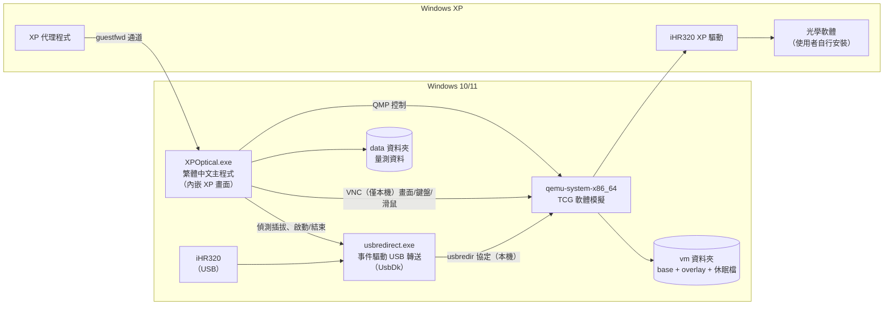

# WinXP Optical System — 系統設計（v0.3，對應程式 v0.1.0）

> 目標：一個在 Windows 10/11 上雙擊即可使用的程式，讓只能在 Windows XP 上操作的光學軟體與 **HORIBA iHR320 分光儀**繼續運作。
> 重點強化 **USB 連接**，關閉後像關機一樣保存狀態，但不帶傳統虛擬機的笨重。

---

## 0. 已確認需求

| 項目 | 內容 | 對設計的影響 |
|---|---|---|
| 儀器 | HORIBA iHR320 分光儀 | 主要支援對象，內建設定檔 |
| 連接方式 | USB | v1 專注 USB；COM 對應降為未來擴充 |
| 攝影機/即時影像 | 沒有 | 不需處理等時傳輸（isochronous），風險大幅降低 |
| 外接偵測器 | 沒有 | 只需轉送 iHR320 一個 USB 裝置 |
| 舊 XP 電腦 | 無法開機 | **無法從舊電腦轉換**，程式需內建「XP 環境建立精靈」，從 XP 安裝光碟全新安裝 |
| XP 授權 | 一般版（零售版） | 零售版授權可移轉到新電腦；使用者自備光碟與序號 |
| XP 光碟版本 | SP3，ISO 檔 | 已含所有更新與 USB 2.0 驅動，不需另外準備 SP3；程式只需支援 ISO，不需直接讀實體光碟機 |
| 光學軟體 | 使用者自行安裝 | 程式提供「安裝軟體模式」與匯入安裝檔功能，不內建任何光學軟體 |
| 介面 | **繁體中文** | 所有畫面、訊息、錯誤提示皆為繁體中文 |
| 執行方式 | **可獨立運行** | 免安裝資料夾、自帶 .NET 執行環境的單一 exe；不依賴使用者另裝任何執行環境 |
| 操作 | **簡易上手** | 首次使用精靈 + 日常「雙擊即用、關閉即存」；隱藏所有虛擬機概念 |

### 0.1 iHR320 相關資料（公開資料查證）

- 電腦介面為 **USB 2.0（相容 USB 1.1）**，並附一個額外的 USB hub 連接埠 —— 在 Win11 上會看到一個 USB Hub，分光儀裝置掛在它後面。轉送時只轉送分光儀裝置本身，不轉送 hub。目前沒有外接偵測器；日後若在 hub 口加接裝置，可在「設定」的「其他 USB 裝置」勾選一併轉送。
- 控制軟體包含 SynerJY、SDK、LabVIEW VI 等；LabVIEW VI 需先安裝 SynerJY 或「USB Spectrometer Utilities」提供的 DLL。NI 論壇使用者回報這些驅動是為 Windows 2000/XP 設計，64 位元系統可能偵測不到單色儀 —— 與本專案的前提一致。
- 因為相容 USB 1.1，即使 EHCI（USB 2.0）出問題，也能退回 UHCI（USB 1.1）運作，可靠度較高。

---

## 1. 問題本質：卡住的是「驅動程式」，不是「軟體」

Windows 10/11 只有 64 位元版本，iHR320 的 XP 時代 USB 驅動程式（32 位元核心驅動）在新系統上無法載入。因此方案是在程式內嵌一個精簡的 XP 執行環境，讓原本的驅動程式和光學軟體在裡面照常運作，再由程式負責把 USB 裝置高效率地接進去。

**硬性限制**：Windows 10/11 不支援把 PCI/PCIe 介面卡交給虛擬環境使用（iHR320 是 USB，不受影響；未來若加裝 PCI 卡類儀器才需注意）。

---

## 2. 現有方案的 USB 缺陷（已從 QEMU 原始碼確認）

| # | 問題 | 原始碼位置 | 對 iHR320 的影響 |
|---|---|---|---|
| 1 | **USB 直通在 Windows 主機上用 10 ms 輪詢**取得傳輸完成事件 | `hw/usb/host-libusb.c` → `usb_host_timer_kick()` | 分光儀掃描是「移動光柵 → 查詢狀態 → 讀值」大量小指令往返，每次往返多等最多 10 ms，逐點掃描會明顯變慢 |
| 2 | Windows 主機上的 USB **沒有熱插拔** | libusb 在 Windows 不支援 hotplug | 儀器關電源再開、或 USB 線鬆脫後，需手動重新掛載 |
| 3 | 需要用 Zadig 之類工具**手動把驅動換成 WinUSB** | `hw/usb/host-libusb.c` 未啟用 UsbDk 後端 | 使用者難操作 |
| 4 | 新式虛擬環境預設 xHCI（USB 3），**XP 沒有 xHCI 驅動** | — | XP 裡看不到裝置 |
| 5 | 序列埠參數不同步、啟動時跳出 COM 設定對話框 | `chardev/char-serial.c`、`chardev/char-win.c` | iHR320 不受影響（USB），未來擴充 COM 時處理 |

---

## 3. 整體架構（v1 精簡版）

為了「可獨立運行、簡易上手」，v1 **不安裝 Windows 服務**，所有功能集中在一個主程式裡；只有第一次使用時需要系統管理員權限安裝 UsbDk 驅動（見 3.3）。



### 3.1 元件

| 元件 | 角色 | 技術 | 來源 |
|---|---|---|---|
| `XPOptical.exe` | 唯一需要雙擊的程式：精靈、XP 畫面、裝置狀態、休眠/還原 | C# .NET 10 WPF，**自帶執行環境的單一檔案** | 自行開發 |
| VM 引擎 | 執行 XP | `qemu-system-x86_64.exe` + 必要 DLL | MSYS2 的 QEMU 套件（已內建 usb-redir 與 libusb） |
| USB 轉送 | 把 iHR320 以 usbredir 協定轉進 XP | `usbredirect.exe`（v1 直接使用）；v2 視需要改為自有模組 | MSYS2 的 usbredir 套件（v0.15.0 含 `usbredirect.exe`） |
| USB 驅動 | 讓轉送程式取得裝置、用完自動歸還 Win11 | UsbDk | Red Hat 開源，已簽章 |
| XP 代理程式 | 資料同步、時間校正、回報狀態 | C（MinGW，目標 XP） | 自行開發 |
| 設定檔 | iHR320 等裝置規則 | JSON | 內建 `profiles/ihr320.json` |

**為什麼 v1 直接用 `usbredirect.exe`？** 它在 Windows 上就是用 UsbDk 加上**獨立事件執行緒**（阻塞式 `libusb_handle_events`）處理 USB，沒有 QEMU 的 10 ms 輪詢問題（已讀原始碼確認）。主程式只要負責「何時啟動/結束它」與 QMP 熱插拔，v1 幾乎不用寫 USB 底層程式碼。

### 3.2 XP 畫面內嵌在主視窗

QEMU 以只綁定本機的 VNC 輸出畫面，主程式內建精簡的 VNC（RFB）檢視器，把 XP 畫面畫在自己的視窗裡：

- 只有一個視窗，標題、工具列、狀態列都是繁體中文
- **關閉按鈕由主程式掌控**：按下關閉 = 自動休眠存檔（直接用 QEMU 自己的視窗則無法攔截關閉動作）
- 使用 QEMU 擴充按鍵事件傳送原始掃描碼，避免中文鍵盤配置錯亂
- 舊軟體多為 1024×768，以整數倍縮放，在高解析度螢幕上不會太小

### 3.3 免安裝資料夾結構（可獨立運行）

```
XPOptical\
├─ XPOptical.exe        ← 使用者只需要雙擊這個（內含 .NET 執行環境）
├─ engine\              ← QEMU、usbredirect（自動呼叫）
├─ drivers\             ← UsbDk 安裝檔（首次使用時自動安裝）
├─ guest\               ← XP 代理程式與自動設定腳本
├─ profiles\ihr320.json ← iHR320 設定
├─ vm\                  ← 自動產生：XP 磁碟映像、休眠檔
└─ data\                ← 量測資料（從 XP 自動同步出來）
```

整個資料夾可以複製到別台 Win10/11 電腦使用（第一次需要再安裝一次 UsbDk）。系統層級的變更只有一項，在首次使用時以一次 UAC 授權完成：安裝 UsbDk 驅動。

不需要開啟 Hyper-V 或 Windows Hypervisor Platform：QEMU 的 WHPX 不支援休眠（migrate 會被擋：缺少 dirty memory tracking），所以 Windows 上一律以 TCG 軟體模擬執行。Win11 實機（i5-8400）實測，x86_64 版引擎的 TCG 比 i386 版快約 30%。

---

## 4. 使用者流程（簡易上手）

### 4.1 首次使用精靈（只做一次）

| 步驟 | 使用者要做的事 | 程式自動做的事 |
|---|---|---|
| ① 環境檢查 | 按「下一步」，同意一次系統管理員授權 | 安裝 UsbDk |
| ② 建立 XP | 選擇 XP 安裝光碟（ISO 檔或實體光碟）、輸入序號 | 產生磁碟映像與自動安裝設定檔，**無人值守安裝 XP**、安裝代理程式、套用精簡與最佳化設定（一次性，約數十分鐘，可離開） |
| ③ 安裝光學軟體 | 把光學軟體/驅動安裝檔的資料夾**拖進視窗**，接上 iHR320，在 XP 裡照原本方式安裝 | 把資料夾即時轉成虛擬光碟放進 XP；偵測到 iHR320 自動接入 |
| ④ 完成 | 按「完成」 | 把目前狀態封存為「出廠狀態」，之後可一鍵還原 |

### 4.2 日常使用

1. 雙擊 `XPOptical.exe` → 數秒後出現 XP 畫面（光學軟體仍停在上次的畫面）
2. 狀態列顯示「🟢 iHR320 已連線」
3. 用完直接按視窗的 ✕ → 自動休眠存檔、iHR320 歸還給 Win11

### 4.3 主視窗工具列（只放少數按鈕）

| 按鈕 | 功能 |
|---|---|
| 匯入檔案 | 把 Win11 的檔案/資料夾變成 XP 裡的光碟 |
| 量測資料 | 開啟 `data` 資料夾 |
| 還原點 | 建立還原點 / 還原到出廠狀態 |
| 設定 | 關閉行為、記憶體大小等（一般使用者不需要動） |

### 4.4 錯誤訊息原則

所有錯誤以白話繁體中文說明**原因與下一步**，例如：
- 「找不到 iHR320。請確認 USB 線已接好、儀器電源已開啟。」
- 「iHR320 正被其他程式使用。請先關閉 Win11 上使用 iHR320 的軟體。」

---

## 5. USB 設計（iHR320）

| 項目 | 設計 |
|---|---|
| **事件驅動傳輸** | `usbredirect.exe`（UsbDk + 專用事件執行緒）→ 本機 socket → QEMU `usb-redir` 裝置，沒有 10 ms 輪詢 |
| **免換驅動** | UsbDk：XP 使用時獨占裝置，結束後**自動回到 Win11 原本的驅動**，不需要 Zadig |
| **熱插拔** | 主程式監聽 Windows 裝置插拔通知；iHR320 出現時啟動 `usbredirect` 並以 QMP `chardev-add` + `device_add usb-redir` 接入 XP；`usbredirect` 結束（裝置拔除/斷電）時 `device_del` |
| **XP 相容控制器** | ICH9 EHCI（USB 2.0）+ 3 組 UHCI 伴隨控制器（USB 1.1），**不使用 xHCI**；iHR320 相容 USB 1.1，可在兩者間自動切換 |
| **韌體重新列舉** | 若 iHR320 的 XP 驅動在連線時讓裝置以不同 VID:PID 重新出現，設定檔 `followReenumeration` 可列出第二組 ID 自動接手（是否發生待 Phase 0 觀察） |
| **休眠前後** | 存檔前先從 XP 移除 USB 裝置，恢復後重新接入，讓 XP 驅動重新初始化（設定檔可改） |
| **診斷記錄** | 可開啟 USB 封包記錄供除錯 |

**實作注意（已在雲端以 QEMU 8.2 驗證）**：對 `usb-redir` 執行 `device_del` 時，QEMU 會**一併刪除它使用的 chardev**，之後不可再呼叫 `chardev-remove`（會回傳「找不到」）。

---

## 6. 狀態保存：「像關機一樣保存，但不像虛擬機一樣冗餘」

### 6.1 儲存分層

| 檔案 | 內容 | 說明 |
|---|---|---|
| `base.qcow2` | 封存的「出廠狀態」：XP + 使用者安裝好的光學軟體 | 精靈完成後**唯讀** |
| `system.qcow2` | 之後的所有變更 | 只存差異 |
| `state.bin` | 記憶體 + 裝置狀態（休眠檔） | 關閉時產生，恢復後刪除 |
| `data\` | 量測資料 | **在 Win11 端**，由代理程式自動同步，可用一般方式備份 |

### 6.2 關閉行為

兩種模式都會把磁碟上的一切保存下來（等同電腦關機）；差別在於程式是否保持開啟：

| 模式 | 動作 | 下次開啟 |
|---|---|---|
| **快速休眠（預設）** | 移除 USB → 暫停 → 記憶體寫入 `state.bin` → 結束 | 數秒內回到**關閉前的畫面**，光學軟體仍開著 |
| 正常關機 | XP 正常關機 | 冷開機，光學軟體重新啟動 |
| 異常中斷（斷電、當機） | 無 | 磁碟內容保留，從冷開機開始（等同 XP 電腦斷電） |

> 若 iHR320 在休眠期間被關過電源，光學軟體記錄的儀器狀態可能與實際不符。Phase 0 會測試恢復後軟體能否自行重新連線；若不能，iHR320 設定檔預設改用「正常關機」。

實作：QMP `stop` → `migrate` 經**本機 TCP** 送到主程式、由主程式寫入 `state.bin.tmp` → 資料停止流入後 `quit` → 確認檔案完整才轉正；恢復時以 `-incoming defer` 啟動 → `migrate-incoming` 監聽本機埠 → 主程式送回檔案 → 狀態變為 paused → 作廢休眠檔 → `cont` → 重新熱插入 USB。

> 為什麼不直接「遷移到檔案」？Windows 版 QEMU 的檔案通道沒有實作非阻塞模式（`io/channel-file.c` 在 WIN32 下標註 not implemented），`file:` 遷移在 Windows 上會失敗；而且 Windows 版 QEMU 傳完後不會主動關閉連線，所以改以「資料停止流入」判斷結束。這兩點都是用 Wine 執行實際隨附的 Windows 版引擎時發現的。

### 6.3 一致性規則

1. `state.bin` 記錄 `system.qcow2` 的世代編號；只要曾冷開機，**先刪除 `state.bin` 再開機**，絕不把舊記憶體狀態套到已改變的磁碟上。
2. `state.bin` 記錄引擎版本；引擎升級前強制一次正常關機。
3. 存檔時裝置組成必須和恢復時的啟動參數一致 —— USB 一律在存檔前移除、恢復後熱插入。

### 6.4 不冗餘的做法

- 使用者看不到任何「虛擬機」設定
- XP 自動安裝後套用精簡設定：關閉自動更新、系統還原、索引服務、視覺效果；記憶體 512 MB
- 只保留一份休眠檔 + 最多 3 個還原點，自動清理
- XP 自動登入；可設定開機後自動啟動光學軟體

### 6.5 還原點

- 「還原到出廠狀態」：數秒內回到精靈完成時的乾淨狀態
- 「建立還原點」：例如校正完成後存一份
- 量測資料在 Win11 端，還原不受影響

---

## 7. XP 環境建立精靈（取代舊電腦轉換）

> v0.2.0 已實作全自動安裝：程式從 ISO 根目錄的 `WIN51IP` / `WIN51IC` 標記辨識專業版/家用版與 SP 版本，產生 1.44 MB 虛擬磁碟片（A:）放入 `WINNT.SIF`（含序號、自動分割、時區台北、1024×768、自動登入）與 `XPOPOST.VBS`。XP 安裝完成後第一次登入時執行該腳本：設定永久自動登入、在 A: 寫入 `DONE.TXT`、以 WMI 強制關機；執行引擎結束後主程式讀取磁碟片確認完成，刪除磁碟片（含序號）並自動開機進入 XP。
> 單一安裝檔（NSIS）包含程式、執行引擎與 UsbDk；安裝檔旁若有使用者自己的 `xp.iso` 會一併複製，程式第一次開啟時直接進入自動安裝。XP 本身不包含在安裝檔中（微軟授權）。代理程式（資料同步）仍屬 Phase 2。

因為舊電腦無法開機，程式需要能從零建立 XP：

| 項目 | 設計 |
|---|---|
| 輸入 | XP 零售版安裝光碟（ISO，或由程式讀取實體光碟製成 ISO）+ 序號 |
| 無人值守安裝 | 程式產生含 `WINNT.SIF` 自動安裝設定（序號、電腦名稱、自動登入、時區/地區、解析度）的虛擬磁碟片，XP 安裝程式開機時自動讀取 |
| 安裝後自動設定 | 透過另一片虛擬光碟執行：安裝 XP 代理程式、套用精簡設定 |
| Service Pack | 使用者的光碟已是 SP3，不需額外處理（若日後遇到較舊的光碟，再由精靈提示另外提供 SP3 安裝檔） |
| 匯入安裝檔 | 使用者拖入的資料夾即時製成 ISO，以 QMP 換片放進 XP 的光碟機 |
| 啟用 | XP 安裝後需完成產品啟用；可行的啟用方式需實際確認（見風險表） |
| 選用 | 若舊電腦只是主機板或電源故障、硬碟仍可讀取，也可以把舊硬碟整顆轉成映像使用（保留原本的軟體與設定） |

---

## 8. XP 代理程式與安全性

- **網路隔離**：XP 使用 QEMU 使用者模式網路並設定 `restrict=on`，**無法連上網際網路或區域網路**，但可透過 `guestfwd` 與主程式溝通
- 代理程式功能：量測資料夾同步（XP → Win11，預設單向）、恢復後立即校正時間、回報「XP 已就緒」、關閉前確認資料同步完成
- 檔案預設只從 XP 流出；Win11 → XP 只能透過「匯入檔案」
- VNC 與 QMP 只綁定本機位址

---

## 9. 裝置設定檔

內建 [`profiles/ihr320.json`](../profiles/ihr320.json)。主要欄位：

| 欄位 | 說明 |
|---|---|
| `vm.ramMB` / `vm.closeAction` | 記憶體大小；關閉行為 `hibernate` / `shutdown` |
| `usb[].match` | 以 VID:PID（及序號）比對；iHR320 的實際 ID 於 Phase 0 從 Win11 裝置管理員讀取後填入 |
| `usb[].followReenumeration` | 韌體下載後的新 VID:PID（若有） |
| `usb[].autoAttach` | 是否自動接入 |

使用者在「設定」中選擇的 iHR320 與其他 USB 裝置存在 `settings.json`，與設定檔的規則合併使用。（USB 一律在休眠前移除、恢復後重新接入，因為存檔時的裝置組成必須和恢復時的啟動參數一致；資料同步等欄位在代理程式完成後加入。）

---

## 10. 授權與法律

- **XP**：程式不附帶 XP；使用者自備零售版光碟與序號。零售版授權可移轉到新電腦（需確保舊電腦不再使用同一份授權）。
- **QEMU、usbredir（GPL/LGPL）**：以獨立程序執行並透過協定溝通；隨附的二進位檔需附上授權文字與原始碼取得方式。若要商業發行，建議請法務確認。
- **UsbDk（Apache 2.0）**：已簽章，可直接隨附。

---

## 11. 開發階段

| 階段 | 內容 | 完成標準 |
|---|---|---|
| **Phase 0：實機驗證** | 用 v0.1.0 在 Win11 + iHR320 上實際操作（[`PHASE0-POC.md`](PHASE0-POC.md)） | 光學軟體能在 XP 中控制 iHR320；量到掃描速度、休眠/恢復時間 |
| Phase 1：可用版 ✅ v0.1.0 | 主程式（繁中）+ 內嵌 XP 畫面 + QMP 控制 + 快速休眠 + iHR320 自動接入（含熱插拔）+ 從 ISO 安裝 XP + 放入檔案（光碟）+ 隨身碟轉送 | 雲端自動化測試通過；待 Phase 0 實機確認 |
| Phase 2：精靈與還原 | XP 無人值守安裝（WINNT.SIF）、出廠狀態/還原點、XP 代理程式（資料自動同步、恢復後校正時間） | 新電腦從零到可用全部透過精靈完成 |
| Phase 3：產品化 | 錯誤訊息與診斷、USB 封包記錄、隨附授權文件、程式碼簽章 | 可交給非技術使用者 |
| 未來擴充 | COM 埠對應（含 Windows 序列埠參數同步修補）、其他儀器設定檔 | 依需求 |

---

## 12. 已驗證事項

| 項目 | 結果 | 驗證方式 |
|---|---|---|
| QEMU 在 Windows 上的 10 ms USB 輪詢、序列埠缺陷 | 確認存在 | 閱讀 QEMU 原始碼 |
| `usbredirect` 在 Windows 使用 UsbDk + 事件執行緒 | 確認 | 閱讀 usbredir 原始碼 |
| Windows 版 QEMU 含 usb-redir / libusb | 確認 | MSYS2 `mingw-w64-ucrt-x86_64-qemu`（11.1.2）相依 usbredir、libusb |
| Windows 版 `usbredirect.exe` 可取得 | 確認 | MSYS2 `mingw-w64-ucrt-x86_64-usbredir`（0.15.0） |
| 完整流程：冷開機、VNC 畫面、USB 接入/拔除/重新接入/取消勾選歸還、休眠、恢復、關機逾時、強制關閉、從 ISO 安裝、匯入映像、放入光碟 | 通過 | 自動化整合測試，分別以 Linux 版 QEMU 8.2 與**實際隨附的 Windows 版 QEMU 11.1.2（透過 Wine）**執行；USB 以假的 usbredirect 代替 |
| 資料夾路徑含中文與空白 | 通過 | 整合測試的工作資料夾刻意含中文與空白 |
| 隨附的 Windows 引擎 DLL 完整 | 通過 | 建置時解析所有 PE 匯入；Wine 實際啟動 qemu-system-x86_64、qemu-img、usbredirect |
| 繁中主程式畫面 | 首次使用畫面、XP 畫面內嵌、狀態列、設定視窗顯示正常；關閉自動休眠、再開恢復成功 | 在 Wine + 虛擬螢幕上執行 XPOptical.exe 並截圖 |
| 從 Linux 編譯 XP 可執行檔（代理程式） | 可行：PE 版本 5.1，只匯入 XP 內建 DLL | 雲端 MinGW 實測 |

| Win11 實機（本機測試端，i5-8400、Win11 Pro 26200） | `dotnet test` 48/48；主程式安裝模式、安裝完成、開啟、關閉休眠（0.6 秒）、再開恢復（0.2 秒）、問題回報按鈕皆正常（以 Alpine ISO 代替 XP 光碟） | 本機測試端回報 #1 |
| WHPX 能否休眠 | 不能：QEMU 在 WHPX 下登錄遷移阻擋（`target/i386/whpx/whpx-all.c`：缺少 dirty memory tracking），所以 Windows 上一律使用 TCG | 本機實測 + 原始碼確認；MSYS2 的 i386 版甚至未編入 WHPX |
| TCG 效能：x86_64 版 vs i386 版 | x86_64 版快約 30%（Alpine 開機 27.0 秒 vs 38.6 秒），改用 x86_64 版 | 本機實測 |

尚未驗證（需要使用者本人在 Win11 實機上）：XP SP3 安裝、UsbDk 安裝與 iHR320 經 usbredir 的實際運作與速度、真正 XP 的休眠檔大小與存檔時間。

### 12.1 實作中發現並修正的 Windows 問題

| 問題 | 原因 | 修正 |
|---|---|---|
| 路徑含中文（例如中文帳號的桌面）時引擎啟動失敗 | Windows 版 QEMU 以系統 ANSI 字碼頁讀取命令列與自身路徑（`system/main.c` 未使用寬字元、`util/cutils.c` 用 `GetModuleFileName`） | QEMU 以 vm 資料夾為工作目錄，只傳純英數路徑（相對路徑 → 8.3 短檔名）；安裝光碟改為複製、匯入來源改為硬連結 |
| 休眠存檔失敗 | Windows 版 QEMU 的檔案通道未實作非阻塞模式 | 改經本機 TCP 傳送（見 6.2） |
| 休眠存檔卡住 | Windows 版 QEMU 傳完不關閉連線 | 以資料停止流入判斷結束，再結束引擎並驗證檔案 |
| 光碟可能被放進軟碟機 | 機器同時有可移除的軟碟機 | 光碟機固定命名為 `cd0` |

---

## 13. 風險與因應

| 風險 | 因應 |
|---|---|
| TCG 軟體模擬跑 XP 與光學軟體的速度 | Phase 0 實測；WHPX 雖較快但不支援休眠，不採用。若實際操作太慢，可加一個選項「硬體加速（關閉時只能正常關機）」 |
| UsbDk 與 Win11 記憶體完整性（HVCI）或公司 IT 政策衝突 | 退回 WinUSB（libwdi 自動安裝）；Phase 0 驗證 |
| UsbDk 一般使用者權限下能否存取裝置 | 若需要系統管理員權限，再加回 Windows 服務負責 USB |
| iHR320 恢復後狀態不一致 | 預設移除/重新接入 USB；必要時改為正常關機 |
| XP 產品啟用方式 | 需實際確認；使用者自備合法授權 |
| 找不到 iHR320 的 XP 驅動安裝檔 | 使用者自行準備（光學軟體與驅動由使用者安裝） |

---

## 14. 尚待確認

1. **iHR320 的 VID:PID**：v0.1.0 起直接在程式的「設定」中選擇 iHR320 即可，不需手動填寫；Phase 0 時記下來，之後可內建到設定檔。
