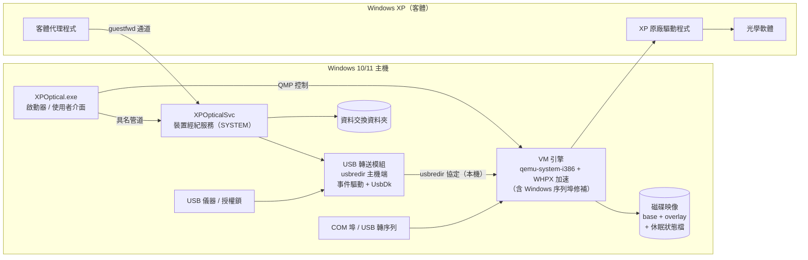

# WinXP Optical System — 系統設計（草案 v0.1）

> 目標：一個在 Windows 10/11 上雙擊即可使用的程式，讓只能在 Windows XP 上操作的舊版光學軟體與儀器繼續運作。
> 重點強化 **USB 與連接埠（COM）**，關閉後像關機一樣保存狀態，但不帶傳統虛擬機的笨重。
>
> 本文件中標示 **【待確認】** 的部分取決於你的實際軟體與儀器，請見最後的「待確認問題」。

---

## 1. 先釐清問題本質：卡住的是「驅動程式」，不是「軟體」

Windows 10/11 其實可以直接執行大多數 32 位元 XP 時代的程式（WOW64）。光學軟體在新系統上失敗，最常見的原因是：

| 原因 | Win10/11 能否解決 | 說明 |
|---|---|---|
| 儀器的 **32 位元核心驅動程式**（.sys） | ❌ 永遠不行 | Win11 只有 64 位元版本，32 位元核心驅動程式無法載入 |
| 舊的 64 位元驅動程式沒有新版簽章 | ❌ 實務上不行 | 驅動程式簽章強制、記憶體完整性（HVCI）會擋 |
| 16 位元安裝程式 | ❌ | 64 位元 Windows 不支援 16 位元程式 |
| 寫死路徑、需要系統管理員權限、舊版 API | ✅ 通常可用相容性修補解決 | 不需要 XP |

因此依軟體狀況分成三條路線：

| 路線 | 做法 | 適用情境 | 本專案定位 |
|---|---|---|---|
| **A. 內嵌輕量 XP 執行環境** | 精簡 XP + 內建 VM 引擎 + 自製 USB/COM 經紀層 | 需要 XP 核心驅動程式（大多數儀器） | **主線** |
| B. 相容層（不跑 XP） | 相容性修補、登錄檔/檔案重導向、COM 號碼別名 | 軟體本身是純使用者模式程式 | 安裝前自動判斷，可行就走 B |
| C. 驅動程式替代 | 攔截軟體對驅動程式的呼叫，改用 WinUSB 在 Win11 上直接和儀器溝通 | 單一高價值儀器、要求最高效能 | 未來外掛（需逐台分析協定） |

> **自我檢查方式**：把舊軟體的安裝光碟/資料夾打開，搜尋 `*.sys` 與 `*.inf`。有 32 位元 `.sys` → 必須走路線 A。

**硬性限制（任何 VM 方案都一樣）**：Windows 10/11 用戶端版本不支援把 **PCI/PCIe 介面卡**（影像擷取卡、運動控制卡、PCI-GPIB、DAQ 卡）直通給 VM。若儀器依賴 PCI 卡，需要改用 USB 版本的介面、保留舊電腦，或走路線 C。**【待確認】**

---

## 2. 現有方案在 USB / COM 上的具體缺陷（已從 QEMU 原始碼確認）

現有「在 Win11 上跑 XP」的工具大多基於 QEMU 或 VirtualBox。以 QEMU（目前主線）為例，Windows 主機上有以下問題：

| # | 問題 | 原始碼位置 | 對儀器的影響 |
|---|---|---|---|
| 1 | **USB 直通在 Windows 主機上用 10 ms 輪詢**取得傳輸完成事件（無傳輸時 1 秒一次） | `hw/usb/host-libusb.c` → `usb_host_timer_kick()`，`CONFIG_WIN32` 分支 | 每個 USB 傳輸最多多等 10 ms。儀器若用大量小指令往返（例如 1000 次讀寫），光等待就多 10 秒 |
| 2 | **序列埠參數不會傳到實體 COM**：XP 裡改鮑率、同位元、流量控制，主機端 COM 不會跟著改；DTR/RTS/CTS 等控制線也不同步。啟動時還會跳出 COM 設定對話框，選定後整個工作階段固定不變 | `chardev/char-serial.c` → `chr_ioctl` 只在 `#ifndef _WIN32` 時註冊；`chardev/char-win.c` 呼叫 `CommConfigDialog` | 儀器通訊失敗、亂碼、需要握手訊號的儀器完全不動 |
| 3 | Windows 主機上的 USB **沒有熱插拔** | libusb 在 Windows 不支援 hotplug | 儀器拔插、重新上電後需手動重新掛載 |
| 4 | 需要用 Zadig 之類工具**手動把驅動程式換成 WinUSB** | `hw/usb/host-libusb.c` 未啟用 libusb 的 UsbDk 後端 | 使用者難操作；換完後該裝置在 Win11 本機就不能用 |
| 5 | 新式 VM 預設 xHCI（USB 3）控制器，**XP 沒有 xHCI 驅動程式** | — | 裝置在 XP 裡看不到 |
| 6 | USB 轉序列線在 Win11 的 COM 號碼會變（COM3 → COM9），舊軟體只認 COM1/COM2 | — | 每次換插孔就要重新設定 |

這六點就是本專案要做出差異化的地方（見第 4、5 節）。

---

## 3. 整體架構



### 3.1 元件說明

| 元件 | 角色 | 權限 | 建議技術 |
|---|---|---|---|
| `XPOptical.exe` | 使用者唯一看到的程式：開啟/關閉、裝置面板、系統匣圖示、還原點 | 一般使用者 | C# .NET 8（WPF），單一檔案發佈 |
| `XPOpticalSvc` | 裝置經紀服務：偵測插拔、認領/歸還 USB 裝置、COM 對應、資料同步 | SYSTEM（Windows 服務） | C# .NET 8 + P/Invoke（SetupAPI / CfgMgr32） |
| USB 轉送模組 | 把實體 USB 裝置以 usbredir 協定轉給 VM | 由服務啟動 | C，使用 `libusbredirhost` + libusb（UsbDk 後端） |
| VM 引擎 | 執行 XP | 一般使用者 | QEMU（`qemu-system-i386`）+ 少量自有修補，Windows Hypervisor Platform（WHPX）加速，失敗時退回軟體模擬（TCG） |
| 客體代理程式 | 在 XP 裡執行：資料同步、時間校正、自動啟動軟體、回報狀態 | XP 內 | C（MinGW，目標 `_WIN32_WINNT=0x0501`，無執行階段相依） |
| 裝置設定檔 | 每套軟體/儀器一份 JSON | — | 見第 8 節 |

**為什麼 USB 轉送不直接改 QEMU？** 把 USB 邏輯放在獨立程序，透過 QEMU 已內建的 `usb-redir` 裝置串接：
- QEMU 幾乎維持原版，升級容易，GPL 邊界清楚（獨立程序、透過協定溝通）
- 熱插拔、裝置規則、診斷記錄全部在我們自己的程式裡掌控
- 已驗證可行性：usbredir 官方工具 `usbredirect` 在 Windows 上就是用 UsbDk + **獨立事件執行緒**（阻塞式 `libusb_handle_events`），沒有 10 ms 輪詢問題

---

## 4. USB 最佳化設計

| 項目 | 設計 | 解決第 2 節的哪一點 |
|---|---|---|
| **事件驅動傳輸** | 每個裝置一條專用 libusb 事件執行緒，傳輸完成立即透過本機 socket 回送 QEMU，延遲從「最多 10 ms」降到「數十微秒」等級 | #1 |
| **免換驅動程式** | 首選 **UsbDk**（Red Hat 開源、已簽章的過濾驅動程式）：VM 使用時獨占裝置，VM 釋放後裝置**自動回到 Win11 原本的驅動程式**。若目標電腦不相容（例如記憶體完整性政策），退回由服務自動安裝 WinUSB（libwdi），使用者不必碰 Zadig | #4 |
| **熱插拔自動掛載** | 服務以 `CM_Register_Notification` 監聽插拔；符合設定檔（VID:PID、序號、實體插孔位置）的裝置自動透過 QMP `device_add usb-redir` 掛進 XP；拔除時 `device_del` | #3 |
| **XP 相容的控制器拓撲** | 固定使用 ICH9 EHCI（USB 2.0）+ 3 組 UHCI 伴隨控制器（USB 1.1），**不使用 xHCI**。USB 1.1 全速裝置（多數舊儀器、授權鎖）走 UHCI，高速裝置走 EHCI | #5 |
| **追蹤韌體重新列舉** | 許多舊光學儀器（Cypress EZ-USB/FX2 系列晶片）在 XP 驅動程式下載韌體後會**以不同 VID:PID 重新出現**。設定檔可列出「下載前/下載後」兩組 ID，服務會自動接手第二次列舉，不會讓儀器「掉」回 Win11 | 舊儀器常見 |
| **休眠前後處理** | 存檔前先把 USB 裝置從 XP 安全移除，恢復後重新插入，讓 XP 驅動程式重新初始化（可依設定檔改為保留） | 見第 6 節 |
| **USB 封包記錄** | 每個裝置可開啟 pcap 記錄（Wireshark 可直接開），方便除錯，也是日後路線 C 分析通訊協定的基礎 | 診斷 |
| **授權鎖（Dongle）** | 視為一般 USB 裝置，設定為「開機即掛載、永不自動釋放」 | — |
| **USB-GPIB** | NI GPIB-USB-HS、Agilent 82357B 這類 USB 介面卡以 USB 轉送，在 XP 內安裝原本的 GPIB 驅動程式 | — |

**限制**：等時傳輸（isochronous，常見於舊式 USB 攝影機/影像擷取）usbredir 有支援，但對延遲敏感，需在 Phase 0 實測。**【待確認：是否有攝影機類裝置】**

---

## 5. COM 埠（序列埠）最佳化設計

### 5.1 對 QEMU 的唯一必要修補：Windows 序列埠參數同步

在 QEMU 的 Windows 序列埠後端補上 `chr_ioctl`（預估約 150–200 行，可提交回 QEMU 上游）：

| XP 內的動作 | 主機端對應 API |
|---|---|
| 設定鮑率、資料位元、同位元、停止位元 | `SetCommState`（DCB） |
| 設定 DTR / RTS | `EscapeCommFunction` |
| 讀取 CTS / DSR / DCD / RI | `GetCommModemStatus` + `WaitCommEvent` 通知 |
| Break 訊號 | `SetCommBreak` / `ClearCommBreak` |

### 5.2 COM 號碼固定對應

XP 內只提供傳統的 COM1–COM4（標準 16550 UART，XP 內建驅動程式，**XP 端不需要安裝任何 USB 轉序列驅動程式**）。設定檔以「USB 轉序列線的序號」或「實體插孔位置」對應：

```
Win11 端 COM9（FTDI，序號 FT1234AB） ──►  XP 端 COM1
Win11 端 COM3（主機板內建 COM）       ──►  XP 端 COM2
```

不論 Win11 把轉接線分配成 COM 幾號，XP 裡永遠是軟體認得的 COM1。COM10 以上自動使用 `\\.\COM10` 路徑格式。

### 5.3 轉接線熱插拔

USB 轉序列線拔除時，服務透過 QMP `chardev-change` 把該 COM 暫時接到空裝置；重新插上後自動接回，XP 內的 COM1 不會消失，軟體不會當掉。

### 5.4 不支援項目

- **並列埠（LPT）**：QEMU 在 Windows 主機上不支援實體並列埠直通。若有 LPT 儀器或 LPT 授權鎖，需另行開發。**【待確認】**
- 超過 4 個 COM 埠：需要額外驅動程式工作，v1 不做。

---

## 6. 狀態保存設計：「像關機一樣保存，但不像虛擬機一樣冗餘」

### 6.1 儲存分層

| 檔案 | 內容 | 說明 |
|---|---|---|
| `base.qcow2` | 精簡後的 XP + 已安裝的光學軟體 | **唯讀**，永不修改，1–2 GB |
| `system.qcow2` | XP 內所有變更（設定、校正檔等） | 疊加在 base 上，只存差異 |
| `state.bin` | 記憶體 + 裝置狀態（休眠檔） | 關閉時產生，啟動恢復後刪除 |
| 資料交換資料夾 | 量測資料 | **放在 Win11 端**（例如「文件\XPOptical\Data」），由客體代理程式自動同步，可用一般備份工具備份，不會被鎖在映像檔裡 |

### 6.2 關閉行為（可在設定檔選擇）

| 模式 | 動作 | 時間（估計，512 MB 記憶體 / SSD） | 下次開啟 |
|---|---|---|---|
| **快速休眠（預設）** | 移除 USB → 暫停 VM → 記憶體狀態寫入 `state.bin` → 結束 | 約 1–3 秒 | 約 2–3 秒回到**關閉前的畫面**，軟體仍開著 |
| 安全關機 | 透過 ACPI 讓 XP 正常關機 | 10–20 秒 | 冷開機（精簡 XP 約數十秒） |
| 異常中斷（斷電、當機） | 無 | — | 磁碟內容保留（等同 XP 電腦斷電，NTFS 日誌自動修復），從冷開機開始 |

實作：QMP `stop` → `migrate` 到 `file:` URI → `quit`；恢復時以 `-incoming defer` 啟動後 `migrate-incoming`，再 `cont`。

### 6.3 一致性規則（避免映像損毀，比照 Windows 休眠的做法）

1. `state.bin` 記錄當時 `system.qcow2` 的世代編號；只要曾經冷開機，**先刪除 `state.bin` 再開機**，絕不把舊的記憶體狀態套到已改變的磁碟上。
2. `state.bin` 記錄 VM 引擎版本；引擎升級前強制一次安全關機。
3. 存檔時 VM 的裝置組成必須固定 —— 這也是 USB 裝置在存檔前先移除、恢復後再熱插入的原因。

### 6.4 「不冗餘」的具體做法

- **沒有 VM 管理介面**：使用者只看到一個程式，不需要建立/設定虛擬機
- **精簡 XP**：移除不需要的元件、關閉分頁檔與系統還原，記憶體 256–512 MB，磁碟 1–2 GB
- **只保留一份休眠檔 + 最多 N 個還原點**（預設 3），自動清理；閒置時可壓縮 overlay
- **自動啟動、單一軟體模式**：XP 自動登入並直接開啟光學軟體，可選擇以光學軟體取代桌面（使用者看不到 XP 桌面）
- **高解析度螢幕**：舊軟體多為 1024×768，啟動器以整數倍縮放顯示，避免在 4K 螢幕上變成郵票大小

### 6.5 還原點（實體 XP 電腦做不到的好處）

- 「還原到出廠狀態」：丟棄 `system.qcow2`，數秒內回到乾淨狀態（例如學生弄壞系統）
- 「建立還原點」：校正完成後存一份，之後可隨時回到這個狀態
- 量測資料在 Win11 端，還原時不受影響

---

## 7. 客體代理程式（XP 內）與安全性

### 7.1 通訊管道

XP 網路使用 QEMU 使用者模式網路並設定 `restrict=on`：**XP 無法連上網際網路或區域網路**，但仍可透過 `guestfwd` 連到主機上的服務。這同時解決兩件事：未修補的 XP 被隔離、代理程式不必佔用任何 COM 埠。

### 7.2 代理程式功能

- 量測資料夾同步（XP `C:\Data` → Win11 資料交換資料夾，預設單向）
- 恢復後立即校正時間（休眠期間 XP 時鐘停止）
- 冷開機後自動啟動光學軟體、回報「軟體已就緒」
- 關閉前通知，確保資料已同步完畢
- 文字剪貼簿共享（可關閉）

### 7.3 安全原則

- XP 預設無網路，只開代理程式通道
- 檔案預設只能從 XP 流出到 Win11；Win11 → XP 需使用者明確拖放匯入
- 服務的具名管道設定 ACL，只允許本機登入使用者
- 服務只做裝置與檔案相關工作，不接受任意命令

---

## 8. 裝置設定檔格式（草案）

每套「軟體 + 儀器組合」一份 JSON，範例見 [`profiles/example-profile.json`](../profiles/example-profile.json)。主要欄位：

| 欄位 | 說明 |
|---|---|
| `vm.ramMB` / `vm.closeAction` | 記憶體大小；關閉行為 `hibernate` / `shutdown` |
| `vm.resumePolicy` | `resume`（回到關閉前畫面）或 `coldBoot`（儀器重新上電後軟體必須重新初始化時使用） |
| `usb[].match` | 以 VID:PID、序號、實體插孔位置比對 |
| `usb[].followReenumeration` | 韌體下載後的新 VID:PID |
| `usb[].onResume` | `replug`（預設）或 `keep` |
| `usb[].returnToHost` | VM 不用時是否交還 Win11 |
| `serial[]` | 主機端（序號/插孔/COM 號碼）→ XP 端 COM1–4 |
| `launch` | 自動啟動的程式、單一軟體模式 |
| `dataSync` | 資料同步路徑與方向 |

---

## 9. 啟動與關閉流程

**啟動**
1. 使用者雙擊 `XPOptical.exe`，讀取設定檔
2. 服務認領設定檔中的 USB 裝置（UsbDk），開啟對應的 COM 埠
3. 有有效的 `state.bin` → 恢復；否則冷開機
4. 恢復完成後，服務依序熱插入 USB 裝置
5. 代理程式回報就緒 → 校正時間 →（冷開機時）啟動光學軟體
6. 顯示視窗

**關閉（快速休眠）**
1. 使用者關閉視窗
2. 代理程式完成資料同步
3. 服務移除 XP 內的 USB 裝置並等待 XP 處理完畢
4. 暫停 VM → 寫入 `state.bin` → 結束 VM 引擎
5. 服務釋放 USB 裝置，裝置回到 Win11

---

## 10. 部署、授權與法律注意事項

- **XP 授權**：本程式**不附帶** Windows XP，使用者須提供合法授權的 XP。建議做法是從現有可運作的 XP 儀器電腦直接轉換（P2V，見 [`PHASE0-POC.md`](PHASE0-POC.md)），連同已安裝、已設定好的光學軟體一起搬過來，也省去找不到原始安裝光碟的問題。轉換後 XP 可能要求重新啟用，取決於授權類型。**【待確認】**
- **QEMU 為 GPLv2**：VM 引擎以獨立程序執行、透過 QMP/socket 溝通；我們對 QEMU 的修補需公開原始碼。若要商業發行，建議請法務確認。
- **驅動程式**：UsbDk 已有簽章；若退回 WinUSB 方案，商業發行時需取得正式程式碼簽章憑證。
- **WHPX**：需在 Windows 功能中啟用「Windows Hypervisor Platform」（安裝程式可代為啟用，需重新開機）。
- **發佈形式**：使用者體驗是「一個 exe」；實際上是安裝程式或免安裝資料夾（啟動器 + 服務 + 引擎 + 映像檔）。XP 映像檔體積大且涉及授權，不打包進 exe。

---

## 11. 開發階段

| 階段 | 內容 | 完成標準 |
|---|---|---|
| **Phase 0：可行性驗證** | 在實際的 Win11 電腦上，用原版 QEMU + `usbredirect` + 實際儀器跑一次（步驟見 [`PHASE0-POC.md`](PHASE0-POC.md)） | 光學軟體能控制儀器；量到 10 ms 輪詢 vs. usbredir 的延遲差異；量到休眠/恢復時間 |
| Phase 1：MVP | 啟動器 + QEMU 控制 + 快速休眠 + 固定 USB 掛載 + COM 對應（含序列埠修補） | 一台儀器每天可正常使用 |
| Phase 2：裝置經紀服務 | 熱插拔、設定檔、韌體重新列舉追蹤、單一軟體模式、客體代理程式 | 拔插儀器、重開 Win11 都不需手動處理 |
| Phase 3：產品化 | USB 封包記錄、還原點、安裝程式、多設定檔、程式碼簽章 | 可交給非技術使用者 |
| Phase 4（選用） | 路線 B 自動判斷；路線 C 驅動程式替代外掛 | 依儀器需求 |

---

## 12. 風險與因應

| 風險 | 因應 |
|---|---|
| WHPX 對 32 位元 XP 客體的相容性 | Phase 0 驗證；退回 TCG 軟體模擬（XP 很輕，介面操作型軟體可接受） |
| UsbDk 與 Win11 記憶體完整性（HVCI）/公司 IT 政策衝突 | 退回 WinUSB（libwdi 自動安裝）；Phase 0 驗證 |
| 等時傳輸裝置（攝影機）效能不足 | Phase 0 實測；必要時該裝置改走路線 C |
| PCI/PCIe 介面卡 | 無法直通，需更換介面或走其他路線 |
| 恢復後儀器實際狀態與軟體認知不一致（例如儀器關過電源） | 設定檔 `resumePolicy: coldBoot` 或 `onResume: replug` |
| XP 啟用/授權問題 | 由使用者提供授權；優先 P2V 現有電腦 |

---

## 13. 待確認問題

設計中所有 **【待確認】** 的項目都來自以下問題，答案會直接影響架構：

1. **軟體與儀器清單**：光學軟體名稱/版本；儀器種類與型號（光譜儀、單色儀、攝影機、功率計、位移平台、鏡片檢測儀……）。
2. **每台儀器的連接方式**：USB 原生（需 XP 專用驅動）、USB 轉 RS-232、主機板 RS-232、USB 授權鎖、USB-GPIB、**PCI/PCIe 卡**、**LPT 並列埠**？（後兩者會改變整體方案）
3. **是否有大量即時資料的裝置**（攝影機、影像擷取、高速 DAQ）？
4. **現有的 XP 電腦還能開機嗎？** 能否直接 P2V 轉換？XP 授權類型（OEM / 零售 / 大量授權）？原始安裝光碟還在嗎？
5. **同一台儀器是否也要給 Win11 原生軟體使用**（需要兩邊切換）？
6. **部署規模**：只在自己實驗室幾台，還是要對外發行/販售？（影響授權、簽章、GPL 合規工作量）
7. **Win11 電腦的管控**：能否安裝驅動程式、啟用 Hypervisor Platform？是否開啟記憶體完整性？
8. **關閉行為偏好**：快速休眠（2–3 秒回到原畫面）還是每次乾淨開機？
9. **開發團隊熟悉的語言**：本設計建議 C#（介面/服務）+ C（USB 模組、XP 代理程式），若團隊偏好 C++ 或 Rust 可調整。
